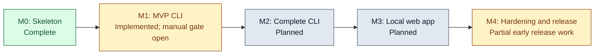

# Feature timeline and completeness

**Status baseline: 2026-11-09 · Latest published software: [v0.1.0](https://github.com/ryamgoh/local-ai-agent-harness/releases/tag/v0.1.0).** This page tracks the approved [specification](SPEC.md) and [numbered implementation plan](tasks/plan.md). [GitHub milestones](https://github.com/ryamgoh/local-ai-agent-harness/milestones?state=all) provide live issue completion; this document is a dated, reviewable snapshot, updated in feature PRs.

## How complete is it?

The **MVP functionality is implemented: 15 of 15 M0–M1 work packages**, including the CLI, MCP tools, JSON tool hooks, agent loop, and both proof plugins. This does not mean that every acceptance gate or the whole planned product is finished.

**MVP acceptance:** all **17 automated criteria** in SPEC #1–12 and #15–19 have evidence; the **one clean macOS/Ollama manual criterion (#20) is still pending**. The hosted OpenRouter demo and a passing macOS CI runner do not satisfy that local-model acceptance check. M1 stays open until it is recorded.

**Full plan:** **14 of 29 numbered tasks are fully closed (48.3%)**, with Task 14 awaiting manual acceptance, Task 28 partially delivered, and the other 13 tasks planned. No partial credit is counted in that percentage. These are unweighted task counts, **not an estimate of effort remaining or a claim that the entire product is 48.3% feature-complete**. The checklist below is the more useful feature-by-feature answer.

Status meanings: **Complete** means implemented with its acceptance evidence; **Acceptance pending** means functionality exists but an exit check is missing; **Partial** means only some task requirements have shipped; **Planned** means the capability is not delivered. Merely having a dependency, schema field, or draft protocol entry does not make a feature implemented.

## Timeline

**Delivered on 2026-11-09:** the TypeScript CLI and proof plugins were implemented and tested; the private repository, cross-platform CI and versioned installation workflow shipped through [PR #1](https://github.com/ryamgoh/local-ai-agent-harness/pull/1); [v0.1.0 was published after gated CI](https://github.com/ryamgoh/local-ai-agent-harness/actions/runs/42553691504); and the real recording/replay assets were added through [PR #7](https://github.com/ryamgoh/local-ai-agent-harness/pull/7). Demo documentation landed after the release; it did not move the software tag or replace its package assets.

**Next:** close the M1 clean macOS/Ollama acceptance gate, then build M2 authoring/distribution capabilities, followed by M3's local UI and M4 hardening. Security work can be brought forward if third-party plugins become a requirement. No calendar deadlines or assignees are committed. The original planning estimates for one experienced developer were M2 **5–7 focused days**, M3 **4–6**, and M4 **4–6**; they are planning estimates, not delivery promises or a new schedule.

Some M4 work deliberately shipped early: private installable tarballs, CI-gated GitHub Releases, install/upgrade/rollback docs, and the recorded demo. **Public npm publication is deferred** under the owner's private GitHub-only distribution decision. A deployed docs site, formal security review and fresh-machine time-bound acceptance have not shipped. Task 28 remains open until those requirements and the adjusted private-distribution exit are agreed and verified.

## M0 — Skeleton: complete

[Live milestone](https://github.com/ryamgoh/local-ai-agent-harness/milestone/1). Strict completion baseline: **1/1 task**.

- [x] [Task 0 — Workspace and CI](https://github.com/ryamgoh/local-ai-agent-harness/issues/8): strict ESM/TypeScript pnpm workspace, real MCP fixture and Linux/macOS Node 22/24 quality matrix.

## M1 — MVP CLI: functionality delivered, acceptance pending

[Live milestone](https://github.com/ryamgoh/local-ai-agent-harness/milestone/2). Strict completion baseline: **13/14 tasks**; all 14 implementation packages exist, but Task 14's manual gate is not closed.

- [x] [Task 1 — Paths, errors and manifest schema](https://github.com/ryamgoh/local-ai-agent-harness/issues/9).
- [x] [Task 2 — Literal variable substitution and path handling](https://github.com/ryamgoh/local-ai-agent-harness/issues/10).
- [x] [Task 3 — Atomic local install/link, registry and lifecycle](https://github.com/ryamgoh/local-ai-agent-harness/issues/11).
- [x] [Task 4 — Schema config, masked secrets and host settings](https://github.com/ryamgoh/local-ai-agent-harness/issues/12).
- [x] [Task 5 — MCP startup, discovery, namespacing and failure isolation](https://github.com/ryamgoh/local-ai-agent-harness/issues/13).
- [x] [Task 6 — PreToolUse/PostToolUse JSON hooks and decision engine](https://github.com/ryamgoh/local-ai-agent-harness/issues/14).
- [x] [Task 7 — Shared validation, hooks and approval gateway](https://github.com/ryamgoh/local-ai-agent-harness/issues/15).
- [x] [Task 8 — Vercel AI SDK agent loop, providers and mock tests](https://github.com/ryamgoh/local-ai-agent-harness/issues/16).
- [x] [Task 9 — Host facade and live inspection](https://github.com/ryamgoh/local-ai-agent-harness/issues/17).
- [x] [Task 10 — Install/list/inspect/config/enable/disable/uninstall/validate CLI](https://github.com/ryamgoh/local-ai-agent-harness/issues/18).
- [x] [Task 11 — Direct tools, run/chat and settings CLI](https://github.com/ryamgoh/local-ai-agent-harness/issues/19).
- [x] [Task 12 — Python notes MCP proof plugin](https://github.com/ryamgoh/local-ai-agent-harness/issues/20).
- [x] [Task 13 — Node guard policy/redaction/audit proof plugin](https://github.com/ryamgoh/local-ai-agent-harness/issues/21).
- [ ] [Task 14 — Proofs/docs and clean macOS/Ollama acceptance](https://github.com/ryamgoh/local-ai-agent-harness/issues/22): automated proofs and documentation are complete; only the specified manual exit remains open.

To close Task 14, attach clean macOS setup, Ollama/model versions, commands, actual tool/results and side-effect evidence for the PLANNING §9 demo. The [real OpenRouter recording](demos/v0.1.0/README.md) is useful evidence of hosted integration, not a substitute. Local-compatible request shapes are tested; LM Studio/vLLM and every possible model are not separately claimed as verified.

## M2 — Complete CLI product: planned

[Live milestone](https://github.com/ryamgoh/local-ai-agent-harness/milestone/3). Strict completion baseline: **0/7 tasks**.

- [ ] [Task 15 — Git/npm plugin sources and consent-aware update](https://github.com/ryamgoh/local-ai-agent-harness/issues/23).
- [ ] [Task 16 — plugin new templates for Node/Python/hooks](https://github.com/ryamgoh/local-ai-agent-harness/issues/24).
- [ ] [Task 17 — plugin test conformance runner](https://github.com/ryamgoh/local-ai-agent-harness/issues/25).
- [ ] [Task 18 — Plugin prompt/slash commands](https://github.com/ryamgoh/local-ai-agent-harness/issues/26).
- [ ] [Task 19 — SessionStart/UserPromptSubmit/SessionEnd hooks](https://github.com/ryamgoh/local-ai-agent-harness/issues/27).
- [ ] [Task 20 — OS keychain, migration and strict-environment hardening](https://github.com/ryamgoh/local-ai-agent-harness/issues/28).
- [ ] [Task 21 — plugin logs, doctor and manifest-only third-party wrapper](https://github.com/ryamgoh/local-ai-agent-harness/issues/29).

Exit: a developer following only the plugin guide can scaffold, test, install and call a new capability. Include SPEC #13–14. Existing owner-only secret files and plugin environment allowlisting remain MVP behavior; they do not complete the keychain milestone.

## M3 — Local web app: planned

[Live milestone](https://github.com/ryamgoh/local-ai-agent-harness/milestone/4). Strict completion baseline: **0/4 tasks**.

- [ ] [Task 22 — Loopback, token-authenticated HTTP API](https://github.com/ryamgoh/local-ai-agent-harness/issues/30).
- [ ] [Task 23 — Plugin list/inspection/toggles/logs UI](https://github.com/ryamgoh/local-ai-agent-harness/issues/31).
- [ ] [Task 24 — Schema-generated config forms with write-only secrets](https://github.com/ryamgoh/local-ai-agent-harness/issues/32).
- [ ] [Task 25 — Streaming chat timeline and approval UI](https://github.com/ryamgoh/local-ai-agent-harness/issues/33).

Exit: every planned CLI capability other than git/npm install has a UI equivalent; local-folder installation works in the UI, with real server-authoritative approvals and SPEC #21 evidence. The feature-development timeline on this page is not the runtime chat timeline; that UI is still planned.

## M4 — Hardening and release: partial early delivery

[Live milestone](https://github.com/ryamgoh/local-ai-agent-harness/milestone/5). Strict completion baseline: **0/3 tasks**, despite the released distribution/demo components.

- [ ] [Task 26 — Opt-in OS filesystem/network sandbox](https://github.com/ryamgoh/local-ai-agent-harness/issues/34).
- [ ] [Task 27 — Restart/backoff, strict descendant cleanup and Windows smoke](https://github.com/ryamgoh/local-ai-agent-harness/issues/35).
- [ ] [Task 28 — Full release hardening, docs site and security review](https://github.com/ryamgoh/local-ai-agent-harness/issues/36): private installable releases, CI and demo shipped; the remaining requirements are listed in the issue.

Declared plugin permissions are **not enforced by an OS sandbox today**. Existing startup/hook timeouts and crash isolation do not establish crash restart or process-tree hardening. Windows support is not verified. No formal OWASP MCP review or deployed docs site is claimed.

## Keep this tracker current

Each numbered task has one native GitHub issue and one milestone. Completed baseline issues were imported retrospectively with evidence; their issue creation/closing times are import times, not original development timestamps. Close future tasks only after their acceptance evidence is linked. Use task-list checkboxes for partial work, and keep an issue open when a manual gate is missing.

Feature PRs update this file and [tasks/status.md](tasks/status.md), including the baseline date/counts and the release that contains the feature. Reference the issue with `Closes #N` only when the entire gate is satisfied; otherwise use a normal reference. Keep implementation PRs **out of milestones** so they do not double-count the one-issue-per-task completion baseline. New scope gets an issue and a documented denominator change, not an unexplained percentage increase.

GitHub updates native milestone percentages when associated issues change. The README and this Markdown snapshot do **not** auto-refresh on issue closure; update them in the associated PR. No recurring automation or background model calls are configured by this tracker.

The [original task plan](tasks/plan.md) is preserved rather than retroactively ticking every test-first/commit step. [tasks/status.md](tasks/status.md) records delivered details; [VERIFICATION.md](VERIFICATION.md) preserves the initial local verification snapshot; [Actions](https://github.com/ryamgoh/local-ai-agent-harness/actions) supplies current remote results; [CHANGELOG.md](CHANGELOG.md) records versioned user-visible changes. Keep future scope and full product completion separate from the v0.1.0 MVP release.

Marketplace, remote HTTP MCP plugins, hot reload, provider plugins, multi-agent orchestration and a desktop shell remain outside the approved v1 scope unless separately added.
