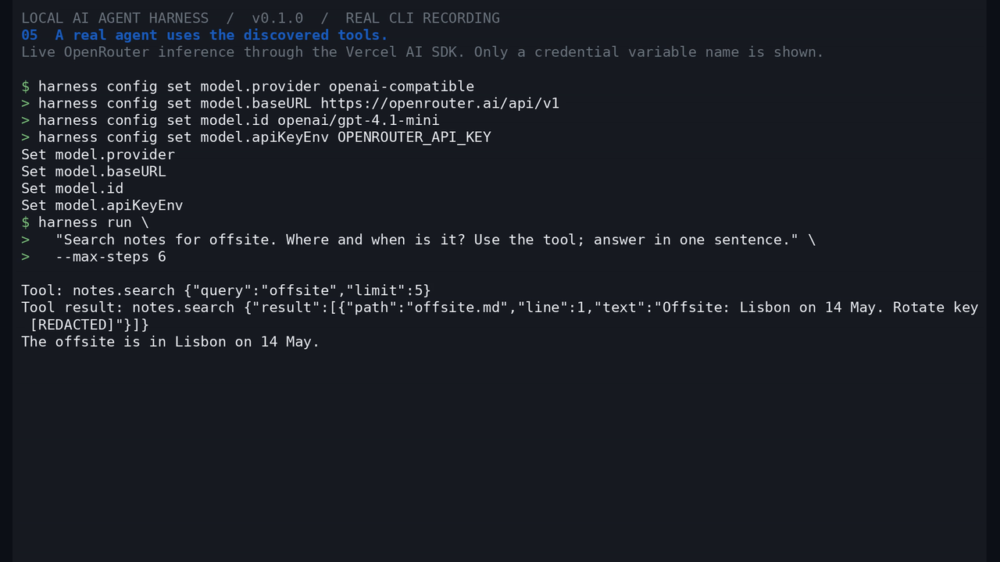

# v0.1.0 recorded demo

[Watch or download the MP4](local-ai-agent-harness-demo.mp4). This is a **2 minute 9 second, 1080p, silent** terminal recording with on-screen explanations and seven embedded chapters. The recording executes the actual published `v0.1.0` package in an isolated Linux sandbox; command typing is scripted for readability, but the results are real.

[](local-ai-agent-harness-demo.mp4)

The host and plugins run locally. The agent segment uses **live OpenRouter inference with `openai/gpt-4.1-mini` through the Vercel AI SDK**, not a scripted answer. Only synthetic note data is used, and credential values are checked absent from the recording and replay files. Ollama is supported but its inference is not demonstrated here.

## Chapters

- **0:00** — Empty host: zero built-in tools.
- **0:14** — Install the Python notes plugin; discover three MCP tools.
- **0:32** — Install the Node guard hook; verify redaction on disk.
- **0:54** — Deny a write even with `--yes`; confirm no file is created.
- **1:14** — Live model calls `notes.search` and answers from the saved note.
- **1:39** — Disable removes tools; enable restores them.
- **1:57** — Summary and execution boundaries.

The demonstration uses `--yes` only for already-reviewed bundled proof plugins and synthetic actions. It never overrides hook denial. Declared permissions are consent information, **not an OS sandbox**; plugins execute with the user's privileges.

## Downloads and replay

The same demo files are supplemental downloads on the private [v0.1.0 release](https://github.com/ryamgoh/local-ai-agent-harness/releases/tag/v0.1.0). Existing package/source assets and the release tag are unchanged. Use an authenticated, invited GitHub account:

```sh
gh release download v0.1.0 --repo ryamgoh/local-ai-agent-harness \
  --pattern 'local-ai-agent-harness-demo.mp4' \
  --pattern 'harness-demo-source.zip'
```

[The source bundle](harness-demo-source.zip) contains the raw `.cast`, executed-command evidence, the recording driver, rendering script, and reproduction instructions. It does not include installed dependencies, runtime state, or credentials. Replaying the [raw terminal recording](local-ai-agent-harness.cast) does not call a model:

```sh
asciinema play local-ai-agent-harness.cast
```

To verify all repository demo files from this directory:

```sh
sha256sum --check DEMO-SHA256SUMS
# macOS alternative: shasum -a 256 -c DEMO-SHA256SUMS
```

Re-recording the live segment requires your own provider credential and may incur charges; do not substitute sensitive notes. The reusable scripts reset only their isolated `workspace/state` directory. Read the source bundle's instructions before running them.

Powered by [asciinema](https://github.com/asciinema/asciinema), [agg](https://github.com/asciinema/agg), and [FFmpeg](https://github.com/FFmpeg/FFmpeg). See [the install guide](../../docs/INSTALL.md) for the CLI itself.
